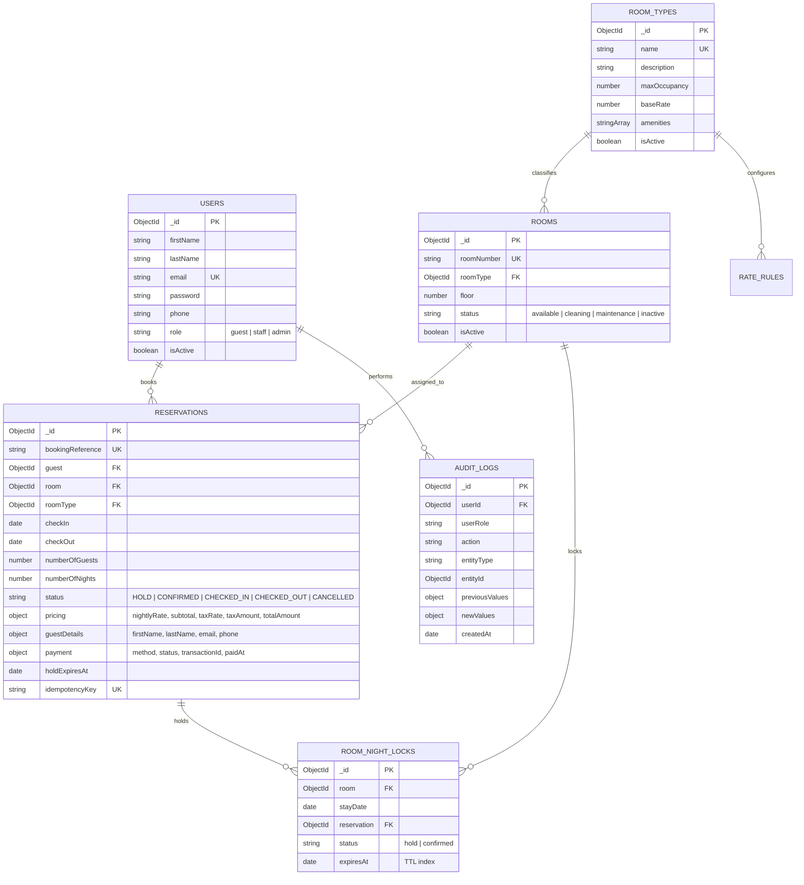

# StayEase — Hotel Booking Management System

A full-stack, database-backed web application built for the **ALGIONS AI LABS PRIVATE LIMITED** Full-Stack Web Development internship assessment.

StayEase demonstrates software engineering fundamentals: robust concurrency protection against double-booking, 10-minute temporary inventory holds with TTL garbage collection, role-based authorization, operations reporting using MongoDB aggregation pipelines, and a minimalist white UI with subtle Ken Burns animations.

---

## 🌟 Key Engineering Features

- **Double-Booking Prevention Engine:** Compound unique index `{ room: 1, stayDate: 1 }` on `RoomNightLock` documents enforces zero overlapping bookings for the same physical room under high concurrency.
- **10-Minute Temporary Hold Lifecycle:** Holds lock room-nights immediately upon booking initiation with live countdown timers and automatic cleanup of abandoned holds before any availability check.
- **Three Segregated User Roles (RBAC):**
  - **Guest:** Search live availability, view itemized pricing snapshots (12% statutory tax), book rooms, simulate payments, view personal reservation history, and cancel eligible bookings.
  - **Staff:** Front desk arrivals and departures boards, guest check-in, room key issuance, check-out, and booking search.
  - **Admin:** Complete console with 7 KPI metrics, Recharts visual analytics, room and category CRUD, occupancy formula reports, and searchable audit logs.
- **Immutable Audit Trail:** All critical operations (logins, status changes, holds, confirmations, cancellations, check-ins/outs) logged with user IDs, roles, and before/after diffs.
- **Simulated Payment Sandbox:** Frictionless checkout with test payment simulations (zero real payment credentials or external gateways required).
- **Automated Test Suite:** 18 passing Jest & Supertest integration tests validating all core business logic and concurrency edge cases.
- **Interactive Swagger/OpenAPI Documentation:** Interactive documentation accessible at `/api/docs`.

---

## 🛠️ Technology Stack

| Layer | Technologies |
|-------|--------------|
| **Frontend** | React 19, Vite, Tailwind CSS v4, React Router DOM v7, React Hook Form, Zod, Lucide React, Recharts, Framer Motion |
| **Backend** | Node.js (v24), Express.js (ES Modules), Mongoose ODM, JWT, bcryptjs, Helmet, CORS, Express Rate Limit |
| **Database** | MongoDB 9.0 (with Replica Set and standalone fallback transaction support) |
| **Testing** | Jest, Supertest |
| **Documentation** | Swagger / OpenAPI 3.0 (`swagger-ui-express`) |

---

## 🗄️ Database Architecture & ER Diagram



---

## 🚀 Getting Started

### Prerequisites
- **Node.js** (v18 or higher recommended; developed on v24)
- **npm** (v9 or higher)
- **MongoDB** running locally or via connection string

---

### Step 1: Clone & Install Dependencies

```bash
# Clone the repository
git clone <repository-url>
cd "HOTEL BOOKING MANAGEMENT SYSTEM"

# Install Backend Dependencies
cd backend
npm install

# Install Frontend Dependencies
cd ../frontend
npm install
```

---

### Step 2: Environment Configuration

Backend configuration (`backend/.env`):
```env
PORT=5000
MONGODB_URI=mongodb://127.0.0.1:27017/stayease
JWT_SECRET=stayease-jwt-secret-key-change-in-production-2024
JWT_EXPIRE=7d
NODE_ENV=development
FRONTEND_URL=http://localhost:5173
COOKIE_MAX_AGE=604800000
```

Frontend configuration (`frontend/.env`):
```env
VITE_API_URL=/api
```

---

### Step 3: Seed Database with Demo Records

Run the idempotent seed script to populate users, room categories, physical rooms, and initial reservations:

```bash
cd backend
npm run seed
```

---

### Step 4: Run the Application

#### Start Backend API Server:
```bash
cd backend
npm start
# Server runs at http://localhost:5000
# Interactive Swagger Docs: http://localhost:5000/api/docs
```

#### Start Frontend Client:
```bash
cd frontend
npm run dev
# Vite runs at http://localhost:5173
```

Open your browser at **`http://localhost:5173`**.

---

## 🔑 Demo Accounts (For Evaluator Testing)

| Role | Email Address | Password | Permissions |
|------|---------------|----------|-------------|
| **Admin** | `admin@stayease.demo` | `Admin@123` | Full Access: Rooms, Categories, Users, Reports, Audit Logs |
| **Staff** | `staff@stayease.demo` | `Staff@123` | Front Desk Concierge: Arrivals, Departures, Check-In, Check-Out |
| **Guest** | `guest@stayease.demo` | `Guest@123` | Public Booking, Hold Creation, Payments, Booking History |

> 💡 **Tip:** The Login Page includes convenient **Quick Demo Credentials** buttons to auto-fill any role with one click!

---

## 🧪 Automated Testing

StayEase includes an automated test suite covering all 18 core assessment scenarios:

```bash
cd backend
npm test
```

### Verified Test Scenarios (18/18 Passing):
1. Guest registration and JWT issuance
2. Rejection of invalid credentials (401)
3. Server-side RBAC: Guest blocked from Admin APIs (403)
4. Admin room type creation
5. Admin room creation with unique numbers
6. Available room search with dynamic pricing
7. Rejection of invalid check-in/out dates (400)
8. Room capacity enforcement
9. Temporary hold creation with RoomNightLocks (10-minute hold)
10. Booking confirmation and promotion of locks
11. **[CRITICAL] Two overlapping reservations cannot confirm the same room (409 Conflict)**
12. Different physical rooms can be booked for the same dates
13. Consecutive non-overlapping bookings allowed on the same room
14. Reservation cancellation immediately releases room inventory
15. Expired holds do not block availability
16. Staff check-in and check-out workflows
17. Tenant data isolation (guest cannot view another guest's bookings)
18. Admin aggregated reports match underlying database records

---

## 📚 API Documentation

Interactive Swagger/OpenAPI documentation is available when the backend server is running:
- **URL:** [http://localhost:5000/api/docs](http://localhost:5000/api/docs)
- **Health Check:** [http://localhost:5000/api/health](http://localhost:5000/api/health)

---

## 📄 Submission Documentation

- **Technical Report & Architecture:** [`docs/technical-report.md`](docs/technical-report.md)

