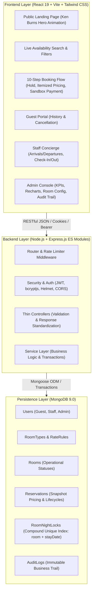
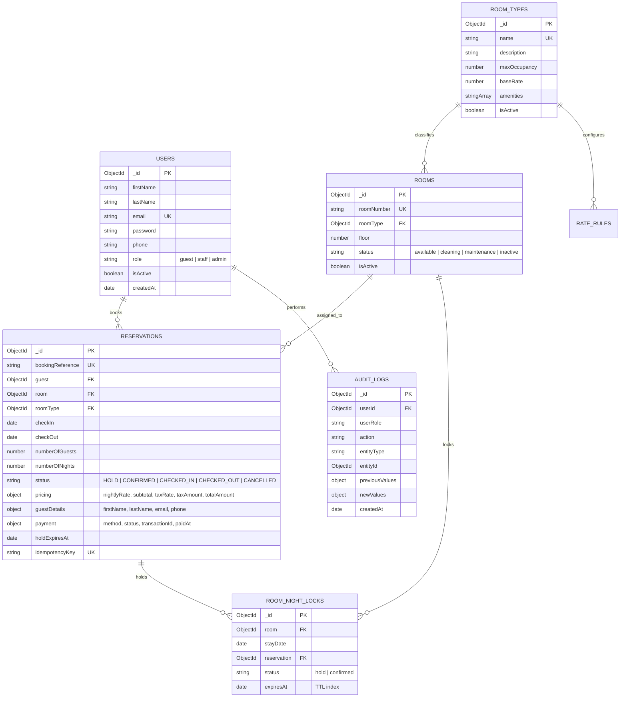
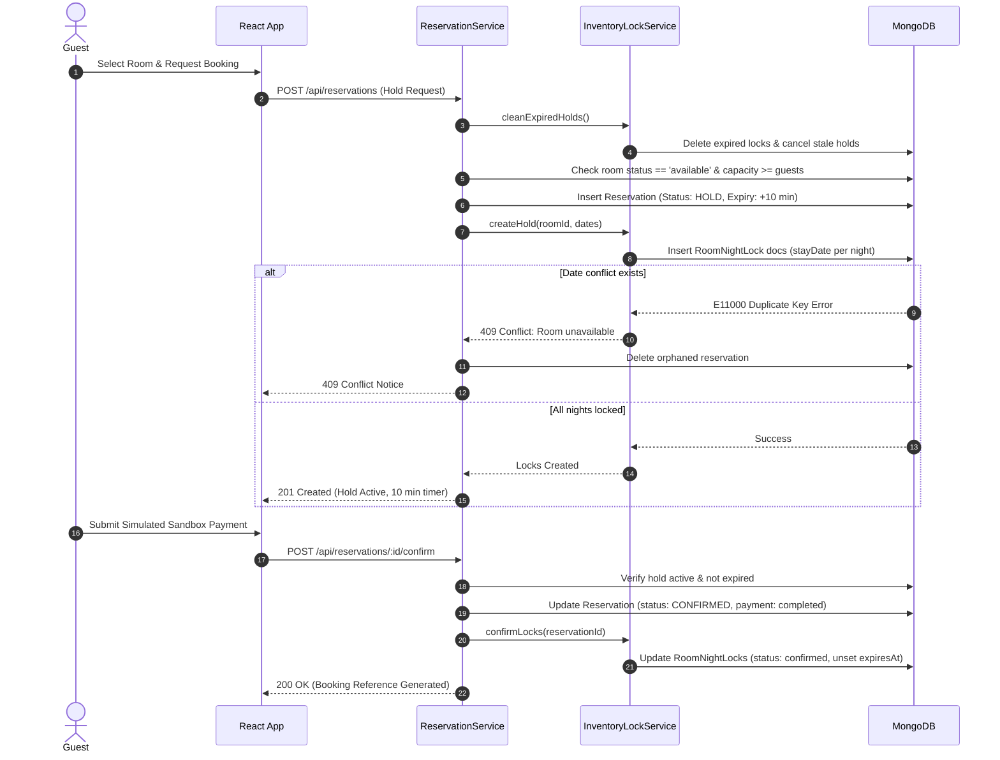

# StayEase: Hotel Booking Management System
## Technical Architecture & Engineering Assessment Report

**Candidate Role:** Full-Stack Web Development  
**Project:** Hotel Booking Management System  
**Organization:** ALGIONS AI LABS PRIVATE LIMITED  

---

## 1. Executive Summary & Problem Statement

Modern hotel booking systems face complex distributed data challenges:
1. **Double-Booking Under Concurrency:** Two concurrent web requests must never be allowed to confirm overlapping reservations for the same physical room unit.
2. **Stale Inventory & Abandoned Holds:** When users start booking but abandon the payment step, rooms can become artificially unavailable indefinitely unless temporary inventory locks are managed with strict TTL garbage collection.
3. **Multi-Role Operational Boundaries:** Guests, front desk staff, and hotel administrators have strictly segregated access requirements that must be enforced server-side.
4. **Financial and Operational Reporting Accuracy:** Nightly rate overrides, occupancy metrics, and tax computations must produce historically snapshot-immutable financial records.

**StayEase** addresses these challenges with a database-backed modular monolith written in plain JavaScript (ES Modules), React, Express.js, and MongoDB.

---

## 2. System Architecture

StayEase follows a layered modular monolith architecture:

---

## 3. Database Design & Entity Relationship Diagram

### Critical Indexing Strategy
1. **Double-Booking Prevention:** Compound unique index on `{ room: 1, stayDate: 1 }` in `RoomNightLock`. Any concurrent write attempting to book or hold the same physical room on the same stay date is immediately aborted by MongoDB with error code `11000`.
2. **Supplementary Hold Eviction:** TTL index on `{ expiresAt: 1 }` with `expireAfterSeconds: 0`.
3. **Query Optimization:** Compound indexes on `{ roomType: 1, status: 1 }` in `Room` and `{ status: 1, checkIn: 1, checkOut: 1 }` in `Reservation`.

---

## 4. Concurrency & Reservation Integrity Engine

The booking lifecycle enforces a zero-collision protocol:

---

## 5. Security & Role-Based Access Control (RBAC)

1. **Password Hashing:** Implemented via `bcryptjs` with salt rounds = 10; passwords stripped from JSON transforms.
2. **JWT Authentication:** Signed with HMAC SHA-256 containing user ID and expiration; supported via secure HTTP headers and HttpOnly cookies.
3. **Role Authorization Middleware:** `authorize('admin')` and `authorize('staff', 'admin')` enforce permissions strictly on the server; clients attempting unauthorized route access receive HTTP 403.
4. **Data Isolation:** Guests can only access their own reservations (`guest: req.user._id`); cross-tenant access attempts return HTTP 403.
5. **Rate Limiting:** Express rate limiters protect auth endpoints against brute force attacks.
6. **Security Headers:** Enforced via `helmet` and custom cross-origin resource policies.

---

## 6. Automated Testing Evidence

The test suite in `backend/tests/api.test.js` exercises all 18 assessment criteria with Jest and Supertest against live MongoDB instances:

| # | Test Scenario | Verified Behavior | Status |
|---|---------------|-------------------|:------:|
| 1 | Guest Registration & Login | JWT returned, password hashed | **PASS** |
| 2 | Invalid Login Rejection | 401 Unauthorized returned | **PASS** |
| 3 | Role-Based Authorization | Guest cannot read Admin APIs (403) | **PASS** |
| 4 | Admin Room Types | CRUD room category configuration | **PASS** |
| 5 | Admin Physical Rooms | Unique room numbering and floors | **PASS** |
| 6 | Availability Search | Dynamic pricing computation | **PASS** |
| 7 | Date Validation | Check-out <= check-in rejected (400) | **PASS** |
| 8 | Capacity Check | Exceeded occupancy rejected (400) | **PASS** |
| 9 | Temporary Hold | 10-minute hold + RoomNightLock | **PASS** |
| 10 | Booking Confirmation | Promotes locks to confirmed | **PASS** |
| 11 | Concurrency Double Booking | Overlapping room dates rejected (409) | **PASS** |
| 12 | Multi-Room Concurrency | Different rooms on same dates succeed | **PASS** |
| 13 | Non-Overlapping Bookings | Consecutive bookings on same room succeed | **PASS** |
| 14 | Cancellation Release | Locks evicted, inventory restored | **PASS** |
| 15 | Expired Hold Eviction | Stale holds evicted before search | **PASS** |
| 16 | Staff Check-In / Check-Out | Operational room state progression | **PASS** |
| 17 | Data Isolation | Guests cannot read other bookings (403) | **PASS** |
| 18 | Report Accuracy | Aggregations match database records | **PASS** |

**Summary: 18 / 18 Tests Passed (100% Success).**

---

## 7. Known Assumptions & Limitations

1. **Sandbox Payments:** Real credit card processing is simulated to ensure security and assessment reproducibility without live credentials.
2. **MongoDB Deployment:** Operates seamlessly with both replica set clusters (using MongoDB multi-document transactions) and standalone MongoDB installations (leveraging MongoDB compound unique constraints for atomic locking with automatic rollback).

